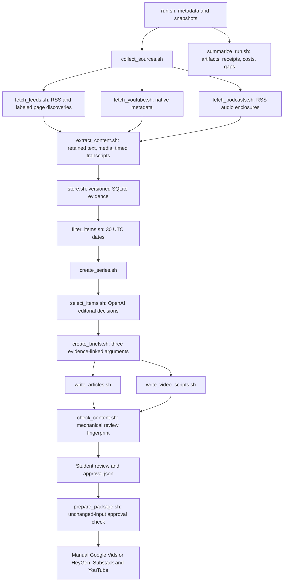

# Implemented architecture

The required course ARCHITECTURE.md is preserved unchanged. Bash owns the entry point and two workflow sequences. Each substantive component has its own focused Python helper behind its required Bash interface. lib/common.py provides I/O, receipts, model transport, and cost reservations; it does not implement stages or orchestrate the whole pipeline.

## Important tradeoffs

SQLite is local, inspectable, and sufficient for a one-user weekly workflow. Store access is confined to store.sh's helper. Other components retrieve exact versions through its commands. Stable identities and immutable assets allow past claims to remain traceable after updates.

A fixed Bash workflow makes sequencing and failure behavior easy to explain. AI performs editorial judgment within bounded stages; this is not a self-directed agent loop. Structured outputs constrain record shape, while application checks verify references and coverage. Neither establishes truth or sound interpretation. Brief generation selects from a retained passage catalogue; deterministic serialization supplies exact source/version/locator fields and canonical claim IDs. Actual article assignments are saved separately from selection intentions.

Public feeds and individual video URLs avoid needing platform-specific credentials. Supplemental research pages broaden evidence but do not count as RSS-discovered written items. Source independence is asserted at producer level and must be reviewed at the claim level; copying a report does not create independent corroboration.

Whisper is a fallback when publisher/YouTube timestamps are unavailable. It adds cost and may introduce transcription mistakes. Exact chunk offsets are retained and machine transcripts need spot checks. Missing or failed sources remain explicit; no synthetic content fills the gaps.

Review fingerprints include manifests, drafts, briefs, decisions, eligible evidence, retained reference text/segments, and run metadata. Direct packaging reassesses these bytes and requires matching student approval. Machine consistency checks mainly ensure a shared claim inventory and resolvable citations; a student must still compare article/script meaning and evaluate synthesis.
